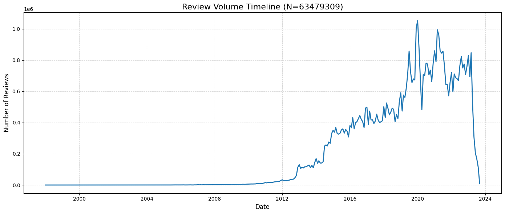
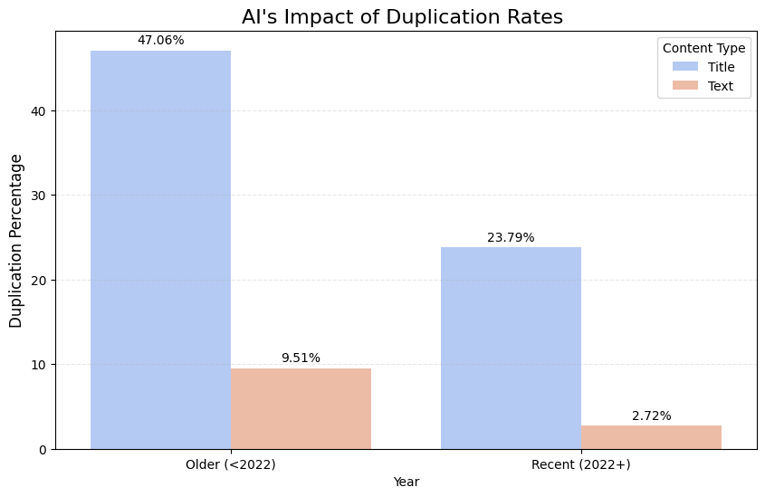
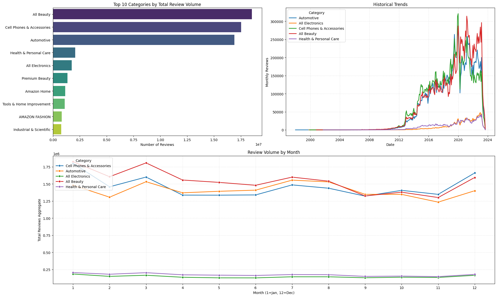
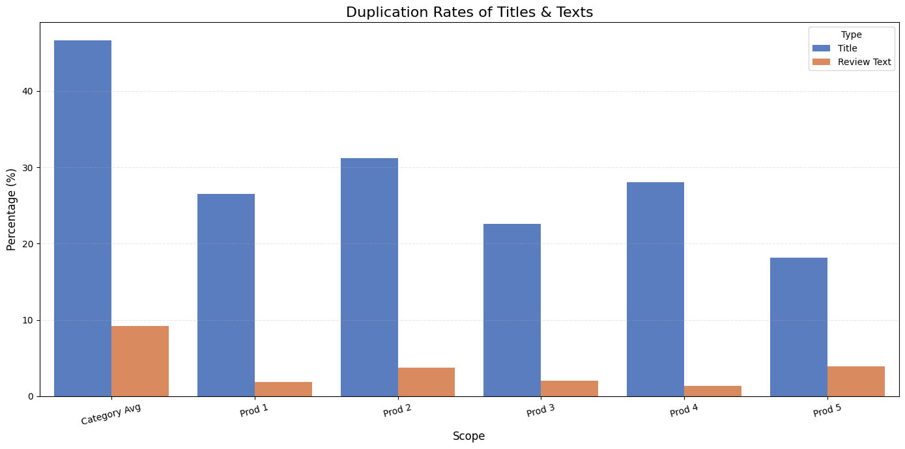
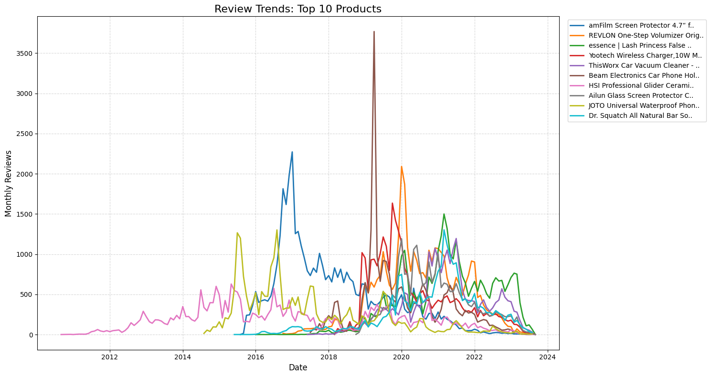
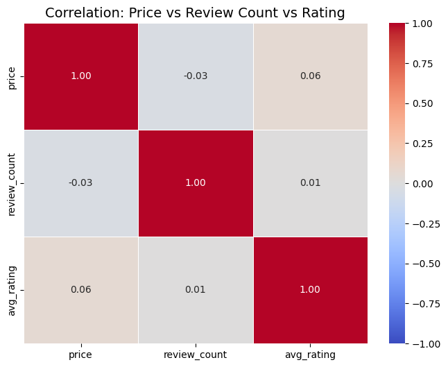
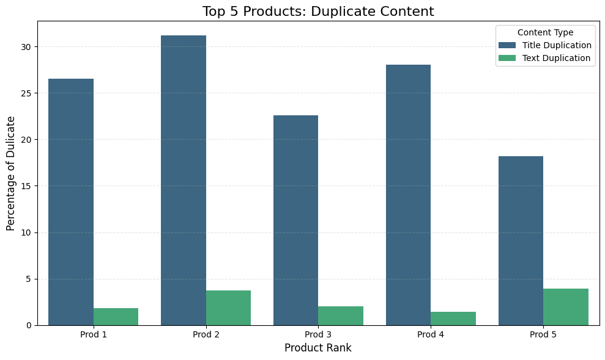

# Detecting AI-Era Review Fraud on Amazon with PySpark & LSH

> **Do AI technologies contribute to fraudulent or redundant product reviews, and can these be detected using scalable similarity-based analysis?**

Final project for **Big Data and Cloud Computing** (Master of Applied Data Science, University of Chicago, Dec 2025).
Author: **Gaoyuan Gu**

📊 **[Presentation (PDF)](report/BDCC_Final_Presentation.pdf)** · 📓 **[Notebooks](notebooks/)**


---

## TL;DR

| | |
|---|---|
| **Data** | Amazon Reviews archive on GCS — ~52 GiB Parquet, **64.7M reviews**, **4.1M products** → **63.5M** reviews after joining |
| **Stack** | PySpark (local mode on Colab high-RAM), GCS connector, pandas, seaborn |
| **Method** | Spark ETL → EDA at scale → MinHash LSH near-duplicate detection (Jaccard ≥ 0.7) |
| **Key finding** | Near-duplicate review text fell from **9.51% (pre-2022) to 2.72% (2022+)** — text-similarity detection is losing power as generated reviews become more diverse |

## Key Findings

1. **Volume is volatile.** Steady growth from 2012 to 2019, a large peak around late 2019 / early 2020, then sharp spikes and drops from 2021 on.
2. **Top products go viral.** Most of the top 10 products collect a large share of their reviews in a short burst, and several share similar spike shapes.
3. **Three categories dominate.** All Beauty (18.5M), Cell Phones & Accessories (17.5M) and Automotive (16.9M) account for most reviews. Seasonality is weak, with small peaks in January and March.
4. **Perfect ratings ≠ popular.** Products rated 4.9–5.0 average only **12** reviews each. The most-reviewed band is 4.0–4.4 (**68** reviews per product).
5. **Price barely matters.** Correlation of price with rating is **+0.06** and with review count **−0.03** (403K products with more than 10 reviews).
6. **Power reviewers look professional.** The top reviewer wrote **3,400** reviews across **24** categories, and all of the top 10 span 13–24 categories.
7. **Titles are templated, texts are not.** In *Arts, Crafts & Sewing*, **46.7%** of titles have a near-duplicate ("Five Stars", "Great") versus **9.2%** of review texts.
8. **Duplication dropped after 2022.** Title duplication fell from 47.1% to 23.8% and text duplication from 9.5% to 2.7%. A lower duplicate rate doesn't mean less spam: it is consistent with copy-paste bots being replaced by generative tools that evade similarity checks.

**Recommendation:** add behavioural signals (review frequency, cross-category spread, purchase history, burst timing) to text-similarity checks rather than relying on them alone.

## Visual Highlights

| Review volume timeline | AI-era duplication |
|---|---|
|  |  |

| Category volume & seasonality | Title vs. text duplication |
|---|---|
|  |  |

<details>
<summary>More figures</summary>

**Top 10 products: monthly review trend**


**Price / review count / rating correlation**


**Top 5 products: title vs. text duplication**


</details>

## Pipeline

```
gs://msca-bdp-data-open/final_project_reviews   (~52 GiB raw Parquet)
        │
        ▼  01_ETL.ipynb ─ PySpark + GCS connector, batched to fit Colab memory
   cleaned_meta_spark/    parent_asin, product_title, main_category, price
   cleaned_review_spark/  parent_asin, user_id, rating, title, text, review_date, year
        │
        ▼  02_EDA_Analysis.ipynb ─ copy to local SSD, price parsing, inner join on parent_asin
   63.5M joined reviews → timeline, top products, categories, ratings, price, words, reviewers
        │
        ▼  03_LSH_Uniqueness.ipynb ─ Tokenizer → HashingTF → MinHashLSH → approxSimilarityJoin
   duplication rate = share of rows with ≥1 near-duplicate (Jaccard similarity ≥ 0.7)
```

### Engineering notes

- **Batched ETL.** 50 meta and 50 review Parquet files are processed in batches of 10 and 5 files, and finished batches are skipped. The job can resume after a Colab disconnect without redoing work.
- **Local SSD staging.** Cleaned data is copied from Drive to the Colab VM's disk before Spark reads it, which avoids slow FUSE-mounted Drive I/O.
- **Memory-safe aggregations.** The top-10 product ranking is computed one year at a time (top 100 per year), then combined in pandas, to avoid a driver OOM on 63M rows.
- **Lean LSH.** Only `(id, features)` goes into the self-join, with 1024 hash features and 2 hash tables. A first attempt on *Car Electronics* with wider vectors crashed the driver, which is why the final analysis runs in its own notebook.

## Repository Structure

```
.
├── notebooks/
│   ├── 01_ETL.ipynb               # GCS → cleaned Parquet batches
│   ├── 02_EDA_Analysis.ipynb      # join + exploratory analysis
│   └── 03_LSH_Uniqueness.ipynb    # MinHash LSH duplication study
├── figures/                       # charts exported from notebook outputs
├── report/
│   └── BDCC_Final_Presentation.pdf
└── requirements.txt
```

## Reproducing

The notebooks were written for **Google Colab** (high-RAM runtime) with Google Drive mounted.

1. Run `01_ETL.ipynb`. It needs read access to `gs://msca-bdp-data-open` (course bucket) and Java 8+ for Spark.
2. Run `02_EDA_Analysis.ipynb` and then `03_LSH_Uniqueness.ipynb`. Both read the cleaned batches from `My Drive/BDCC_Final_Project/`.

To run locally, install `requirements.txt` plus a JDK, and replace the `google.colab` / Drive paths with local ones.

> The dataset belongs to the course and is not redistributed here. A public equivalent is the [Amazon Reviews 2023](https://amazon-reviews-2023.github.io/) dataset (McAuley Lab, UCSD).

## Limitations

- LSH duplication rate is a proxy for templated or copied content, not a fraud label. Without ground truth, the post-2022 drop could also reflect changes in platform moderation or a smaller recent sample (5.3K vs. 41K reviews in the category studied).
- The similarity analysis covers one category, as the assignment specified.
- MinHash on bag-of-words tokens ignores word order. Short titles hit the threshold easily, which inflates title duplication.

---

<details>
<summary>中文简介</summary>

**项目**：芝加哥大学应用数据科学硕士《大数据与云计算》课程期末项目，主题是生成式 AI 是否导致亚马逊虚假或重复评论增加，以及基于相似度的检测方法（LSH）能否发现它们。

**做法**：用 PySpark 从 GCS 分批清洗约 52 GiB 的评论和商品数据，连接后得到 6350 万条评论，完成时间线、热门商品、品类、评分、价格、高频词、活跃用户等 EDA；再在 *Arts, Crafts & Sewing* 品类上用 MinHash LSH（Jaccard ≥ 0.7）衡量标题和正文的近似重复率。

**结论**：标题重复率高（46.7%），正文较低（9.2%）。2022 年之后正文重复率从 9.5% 降到 2.7%，说明传统文本相似度检测对 AI 生成的评论效果在下降，建议结合用户行为特征（发帖频率、跨品类分布、购买记录等）进行检测。

</details>
